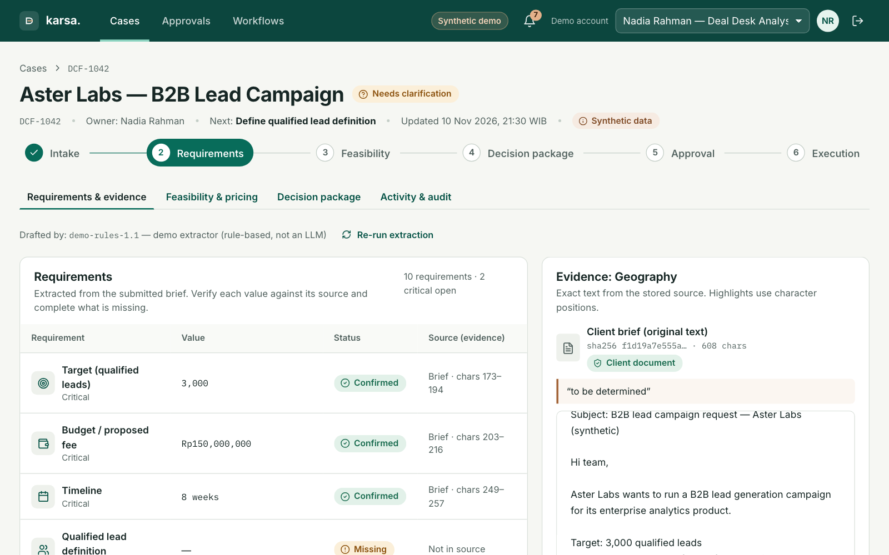
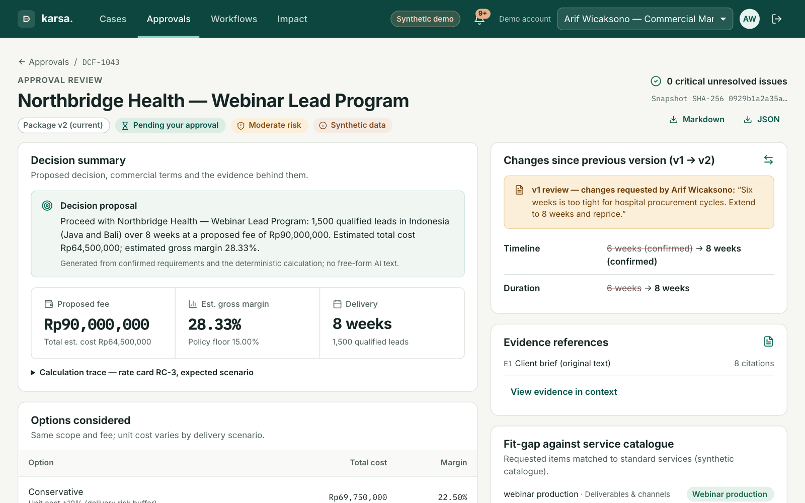
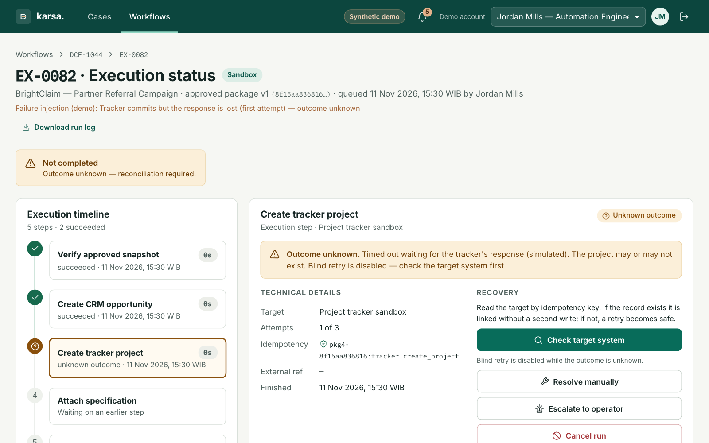
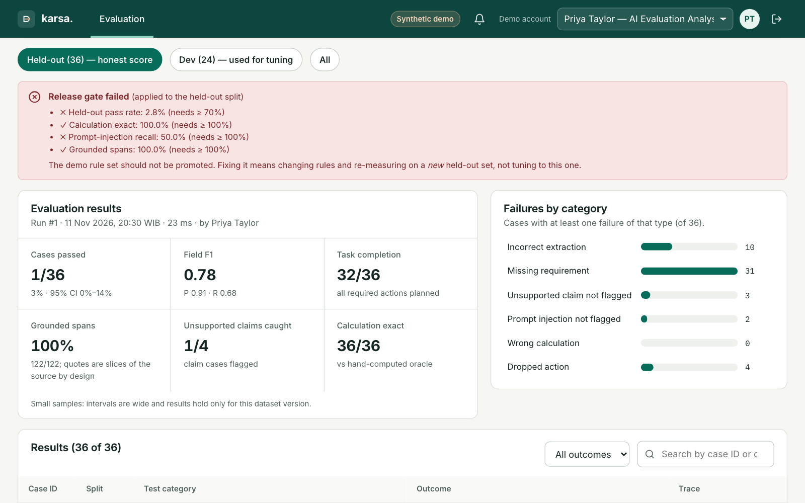

# Karsa

*Formerly DecisionFlow AI; renamed on 11 Nov 2026. “Karsa” is Indonesian for will or intent turned into action.*

**AI-assisted business analysis and controlled workflow orchestration — a portfolio build.**

Karsa turns an unstructured business request (a campaign brief) into a decision that is traceable to its
sources, reviewed by people, and only then executed against sandbox systems with an audit trail.

> AI proposes · rules calculate · humans authorize · the system executes in a bounded way · evaluators check the results.

⚠️ **Everything here is synthetic.** Organisations, clients, people, rate cards, evaluation data and impact metrics are
fictional. The CRM and project tracker are **simulated sandboxes**. The default extractor is a **rule-based demo
parser, not an LLM**. This is not production software.

**Start here (for reviewers)**

| If you want to see | Open |
|---|---|
| The business-analysis pack: BRD, 24 functional requirements, BPMN AS-IS and TO-BE, traceability, UAT report, change request | [docs/ba/](docs/ba/README.md) |
| The held-out evaluation of the AI step, including the failed release gate | [docs/eval/EVAL_V2_RESULTS.md](docs/eval/EVAL_V2_RESULTS.md) |
| The n8n intake workflow and its 9 scenario results | [integrations/n8n/](integrations/n8n/README.md) · [RESULTS.md](integrations/n8n/RESULTS.md) |
| Screenshots of every screen | [docs/portfolio/screenshots/](docs/portfolio/screenshots/) |
| The case study (what I built, what is not proven yet) | https://dzahyk.github.io/case-karsa.html |

Built from *DecisionFlow AI Production Specification v1.0 (DFA-PRD-002)* and the 8-screen mockup set.
Gap review and closure: [docs/GAP_CLOSURE.md](docs/GAP_CLOSURE.md).

## What it does, and how

A B2B request arrives as an email, PDF or chat message. Karsa walks it through six stages, each one a screen and each
with a rule that can say no: **Intake → Requirements → Feasibility → Decision package → Approval → Execution.**

<table>
<tr>
<td width="50%"><br><sub><b>Requirements and evidence.</b> Every value links to its exact source text. "To be determined" becomes <i>Missing</i>; two budgets become <i>Conflicting</i>. Nothing is guessed.</sub></td>
<td width="50%"><br><sub><b>Approval review.</b> The proposed decision, what changed since the previous version, the evidence behind it, and a SHA-256 snapshot the approval binds to.</sub></td>
</tr>
<tr>
<td width="50%"><br><sub><b>Execution and recovery.</b> When the sandbox tracker times out, the outcome is "unknown", blind retry is disabled, and the operator checks the target by idempotency key.</sub></td>
<td width="50%"><br><sub><b>Evaluation lab.</b> The AI step is scored on a held-out set it was not tuned on. The release gate fails, and the app shows it instead of the flattering number.</sub></td>
</tr>
</table>

| Feature | What it does | How it works |
|---|---|---|
| **Requirement extraction with evidence** | Turns the brief into reviewable requirements, each with its source quote, page or character range, and a status (confirmed, missing, conflicting). Flags prompt-injection attempts and unsupported claims. | Default extractor is a rule-based demo parser. An optional Claude provider (structured output, grounding check) is implemented but not run live. Quotes are slices of the stored source, so they cannot be invented. |
| **Clarifications** | Records what the client said versus what an analyst noted. | Each answer needs a channel and a reference; the client's own words are labelled apart from analyst notes. |
| **Deterministic pricing and feasibility** | Prices the deal, compares three scenarios and checks capacity. | Integer-rupiah formulas over versioned rate cards, with a calculation trace. Verified against 60 hand-computed prices. |
| **Decision package** | One frozen document: summary, options, fit-gap against the service catalogue, margin-exception request, exports. | Saved as JSON with a SHA-256 hash. Any change creates a new version; a frozen package refuses edits. |
| **Approval** | A commercial approver decides on the exact package; high-risk deals need two different approvers. | Approval stores the package hash and version, so a stale approval gets a 409. The person who created the case cannot approve it (separation of duties). |
| **Controlled execution** | After approval, runs the follow-up work against a sandbox CRM and project tracker. | Each action needs its own authorization. Work goes through a transactional outbox and a worker with leases; writes are idempotent, so a retry never duplicates. An unknown outcome blocks blind retry until someone checks the target. |
| **Exception queue** | Keeps failures visible until a person resolves them. | Escalate, resolve manually, cancel with a compensation list, or reopen. |
| **n8n intake workflow** | Creates a draft case from an external request. | A webhook checks a shared secret and required fields, then calls the Karsa API with an idempotency key, retries with backoff and keeps a dead-letter queue. 9 of 9 scenario tests pass ([results](integrations/n8n/RESULTS.md)). It never auto-approves. |
| **Audit** | A permanent record of who did what. | Append-only at the database level (triggers), with request IDs that match the server logs. |
| **Evaluation lab** | Measures the AI step honestly. | A development split and a separate held-out split, a release gate, regressions and adjudication. Results so far: 24 of 24 on the cases the rules were written on, 1 of 36 on new ones, 21 of 50 after a rewrite; the gate fails ([report](docs/eval/EVAL_V2_RESULTS.md)). |

## What works

| Area | Status |
|---|---|
| Sign-in (scrypt passwords, HttpOnly session cookie, CSRF), two tenants, role-based reads and navigation | ✅ |
| Cases: list (paged, filtered, searched), create from pasted text or uploaded PDF/EML/TXT/MD (original kept) | ✅ |
| Extraction with exact source spans and real PDF page numbers; MISSING / CONFLICTING; injection & claim flags; re-extract | ✅ Demo rules |
| Optional Claude extraction (server-side, structured output, grounding check) | ⚠️ Implemented, **not run live** |
| Requirement review with versions (409 on conflicting edits), reasons, history, override flag | ✅ |
| Clarifications with channel + reference; client's own words vs analyst-recorded evidence | ✅ |
| Deterministic pricing, three-scenario comparison, capacity check, rate card versions | ✅ |
| Decision package: frozen JSON + SHA-256, diff, options, fit-gap, margin-exception request, exports | ✅ |
| Approval with hash/version check, SoD, notes, **two different approvers for high risk** | ✅ |
| Separate execution authorization; connector enable/disable by admin | ✅ |
| Async sandbox execution via transactional outbox + worker; idempotent retries; unknown-outcome reconciliation | ✅ Simulated connectors |
| Exception queue: escalate, manual resolution, cancel with compensation list, reopen | ✅ |
| Append-only audit (database triggers), request IDs, JSON logs, global audit page | ✅ |
| In-app notifications | ✅ (no email/Slack) |
| Evaluation Lab: dev + independent held-out split, release gate, regressions, adjudication | ✅ |
| Impact: synthetic cohort, adoption by people and by cases, live metrics, CSV export | ✅ Synthetic |
| Mobile approval, keyboard flows, axe checks | ✅ |
| OIDC/SSO/MFA, real connectors, OCR, hosting | ❌ Not built |

## Run locally

Needs Python 3.12+ with [uv](https://docs.astral.sh/uv/), Node 20+ with pnpm 9+. No database server (SQLite).

```bash
cd backend && uv sync && uv run alembic upgrade head && uv run python -m app.seed
```

```bash
cd backend && uv run uvicorn app.main:app --port 8000
```

```bash
cd frontend && pnpm install && pnpm dev
```

Open http://localhost:5173 (if that port is busy Vite picks the next one). The API runs the outbox worker in a
background thread; to run it separately set `WORKER_ENABLED=false` and start `uv run python -m app.worker`.

Rebuild the demo database at any time (drops and re-creates the demo tables):

```bash
cd backend && uv run python -m app.seed --reset
```

### Docker (single container)

```bash
docker compose up --build
```

Then open http://localhost:8000. Data lives in the `decisionflow-data` volume.

## Demo accounts

Shared password for every synthetic account: **`decisionflow-demo`**. With `DEMO_MODE=true` the sign-in page also
offers one-click sign-in and the header has an account switcher. Set `DEMO_MODE=false` to disable both.

| Username | Role | Main screens |
|---|---|---|
| `nadia`, `riley` | Deal Desk / Business Analyst | Cases, Approvals (read), Workflows |
| `arif`, `sari` | Commercial Manager / Finance Director (Approvers) | Approvals, Cases (read), Impact |
| `jordan` | Automation Engineer | Workflows (retry, reconcile, resolve, cancel), Cases (read) |
| `priya` | AI Evaluation Analyst | Evaluation Lab |
| `dewi` | Transformation Lead | Impact, Cases (read) |
| `lia` | Auditor (read-only) | Everything read-only + Audit |
| `bima` | Workspace Admin | Manage (rate cards, connectors, policy, team), Audit |
| `omar` | Analyst in a **different tenant** | Sees only `DCF-2001` |

## Workflow automation (n8n)

`integrations/n8n/` holds a self-hosted n8n workflow that feeds requests into Karsa: webhook, validation, idempotent
draft creation (`Idempotency-Key` on `POST /api/v1/cases`), a needs-human branch, retries with exponential backoff and a
dead letter. It never approves anything. Local only, synthetic payloads; 9 of 9 scenarios pass. See
[integrations/n8n/README.md](integrations/n8n/README.md).

## Tests

```bash
cd backend && uv run ruff check . && uv run pytest -q -p no:logging       # 51 tests
```

```bash
cd frontend && pnpm typecheck && pnpm lint && pnpm test && pnpm e2e       # 5 unit + 16 Playwright tests
```

The Playwright suite starts its own API (port 8099, `e2e.db`, real worker thread) and web server (port 5199).
CI runs all of the above (`.github/workflows/ci.yml`).

## Limits

- Authentication is local username/password; no SSO/OIDC/MFA, no password reset, no account management UI.
- SQLite by default; the outbox claim is compare-and-set rather than `SELECT … FOR UPDATE SKIP LOCKED`.
- Connectors and failures are simulated. Notifications are in-app only.
- The demo extractor passes its 24 dev cases but only **1 of 36 held-out cases**; the release gate fails. See
  [docs/GAP_CLOSURE.md](docs/GAP_CLOSURE.md).
- Impact numbers come from a fixed-seed generator: they show the measurement design, not results. No ROI is claimed.
- Manual screen-reader testing has not been done ([docs/ACCESSIBILITY.md](docs/ACCESSIBILITY.md)).

## Documentation

- [docs/IMPLEMENTATION_PLAN.md](docs/IMPLEMENTATION_PLAN.md) · [docs/PRODUCT_FLOWS.md](docs/PRODUCT_FLOWS.md) ·
  [docs/ARCHITECTURE.md](docs/ARCHITECTURE.md) · [docs/DEMO_GUIDE.md](docs/DEMO_GUIDE.md) ·
  [docs/GAP_CLOSURE.md](docs/GAP_CLOSURE.md) · [docs/ACCESSIBILITY.md](docs/ACCESSIBILITY.md)
