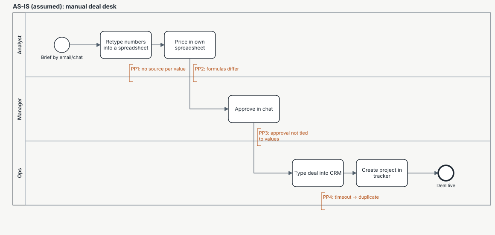
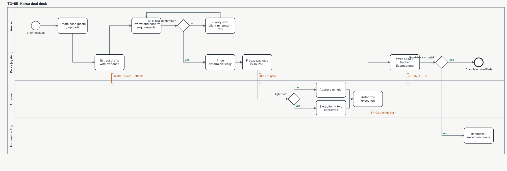

# Process models — AS-IS and TO-BE

Both diagrams are BPMN 2.0 files with diagram interchange (`bpmn/asis.bpmn`, `bpmn/tobe.bpmn`). They open in
bpmn.io or Camunda Modeler: both were loaded into bpmn-js 17.11.1 on 12 Nov 2026 with zero import warnings. The SVGs
next to them are drawn from the same model by `bpmn/build_bpmn.py`, so the pictures and the files cannot drift apart.

## AS-IS (assumed)

The AS-IS is **assumed from the specification's problem statement**, not observed at a real organisation. Its four
pain points are the failure modes in [`01_BRD.md`](01_BRD.md) §1:

| Pain point | Where | Consequence | TO-BE control |
|---|---|---|---|
| PP1 No source per value | Retyping numbers | Wrong or invented values reach pricing | Every value carries a quote + offsets (FR-02) |
| PP2 Formulas differ | Personal spreadsheets | Same deal, different price | Deterministic pricing on a versioned rate card (FR-07) |
| PP3 Approval not tied to values | Approval in chat | CRM receives values nobody approved | Approval binds the package hash; execution re-verifies it (FR-10) |
| PP4 Timeout → duplicate | Typing into CRM | Duplicate records or a blind retry | Idempotent steps and unknown-outcome reconciliation (FR-17, FR-18) |

## TO-BE (built)

| Step | Lane | Rule enforced | Requirement |
|---|---|---|---|
| Extract drafts with evidence | Karsa | BR-009, AC-01 | FR-02, FR-03, FR-04 |
| Review and confirm; clarify while anything critical is open | Analyst | — | FR-05, FR-06 |
| Price deterministically | Karsa | BR-002, BR-013 | FR-07, FR-08, FR-16 |
| Freeze package (SHA-256) | Karsa | BR-001 | FR-09 |
| High risk? → single approval or exception + two approvers | Approver | BR-003, BR-006 | FR-10, FR-12, FR-13 |
| Authorize execution (separate act) | Approver | BR-005 | FR-14, FR-15 |
| Write CRM + tracker, read back against the hash | Karsa | BR-007, AC-05, AC-06 | FR-17, FR-18 |
| Reconcile / exception queue | Automation Eng. | — | FR-19 |

Not drawn, to keep the diagram readable: the reject and request-changes paths (they return the case to the analyst
and, for a change, create a new package version — see [`06_CHANGE_REQUEST_CR-001.md`](06_CHANGE_REQUEST_CR-001.md)).
