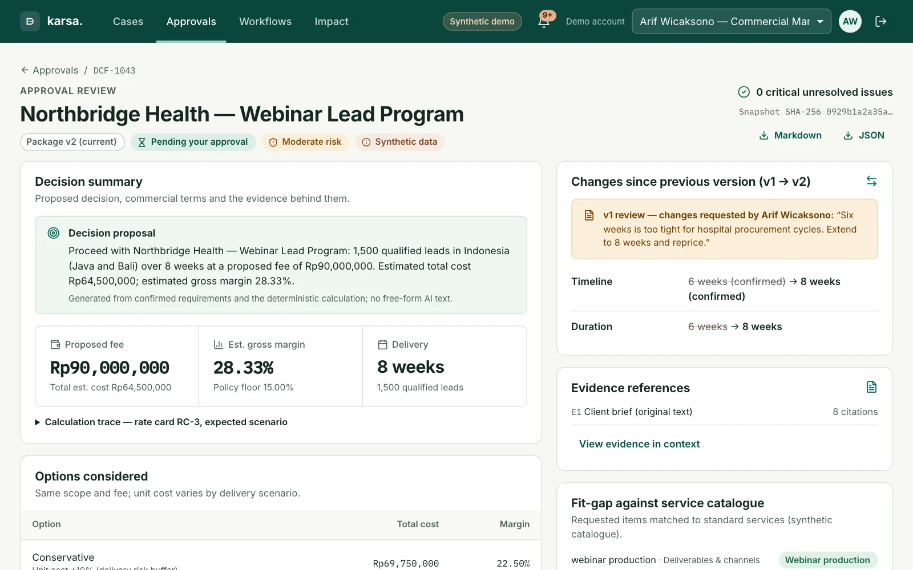

# Karsa (formerly DecisionFlow AI) — case study

> Prototype on synthetic data. No client, users or measured business result is claimed.

**From unstructured requests to decisions people can trace, approve and act on.**

| | |
|---|---|
| **Domain** | AI-assisted business analysis & workflow orchestration (B2B campaign deal desk) |
| **Role** | Solo — spec review, UX, backend, AI integration, evaluation, testing, delivery |
| **Stack** | FastAPI, SQLAlchemy + Alembic (SQLite / PostgreSQL), React + TypeScript, Playwright; Claude API optional |
| **Timeline** | November 2026 |
| **Status** | Working prototype · 51 backend tests + 16 browser tests · Docker image |

---

## 01 · The problem — a fast answer is not the same as a defensible decision

B2B requests arrive as emails, PDFs and chat messages. Targets, budgets and lead definitions are incomplete or
contradictory; costs are worked out in spreadsheets; approval happens in a chat; and the follow-up work in the CRM and
project tracker is copied by hand, if at all. Adding an LLM speeds up reading the brief, but it also adds new risks:
invented values, misread numbers, instructions hidden in documents, and actions that silently never happen.

The goal was one request in, and out a decision package with sources, assumptions, cost, risks and an approver — then
execution only of what was approved, with proof that it happened.

> *From the product spec:* AI proposes; business rules calculate; people authorize; the system executes in a bounded
> way; evaluators check the results.

## 02 · Who it is for

| User | What they do in the app |
|---|---|
| Deal desk analyst | Reviews AI-drafted fields against the source, asks the client, prices the deal, freezes the package |
| Commercial approver | Reads the summary, changes since the last version and the evidence; approves, rejects or requests changes |
| Second approver | Must confirm high-risk deals — the same person cannot approve twice |
| Automation engineer | Runs the approved workflow, retries safely, reconciles unknown outcomes, works the exception queue |
| AI evaluation analyst | Runs the benchmark, reads failures, adjudicates them |
| Transformation lead | Compares cycle time and adoption against a manual baseline |
| Auditor / admin | Reads the append-only audit log; manages rate cards and connectors |

## 03 · Key decisions — AI where it helps, rules and people where it matters

1. **Every value has a source or is visibly missing.** The extractor must return the exact quote and its character
   position (or PDF page). Nothing is guessed: “to be determined” in a brief becomes *Missing*, and two budgets become
   *Conflicting* with both quotes shown. Answers from clients need a checkable reference, and an analyst's note is
   labelled differently from the client's own words.
2. **Approving is not executing.** A package is frozen as canonical JSON with a SHA-256 hash. Approval binds to that
   hash; any later change creates a new version. High-risk deals (margin below the policy floor) need a written exception
   and two different approvers. Execution needs a separate authorization of each named sandbox action.
3. **Failures stay visible until a person resolves them.** Execution runs through a transactional outbox and a worker
   with leases. Writes are idempotent, so retries never duplicate. When a timeout leaves the outcome unknown, blind
   retry is disabled until someone checks the target system. Escalation, manual resolution and cancellation (with a
   compensation list — nothing is deleted silently) live in an exception queue.
4. **Measure on data you did not tune on — and report the bad news.** The benchmark has a dev split I used while
   writing the extraction rules and a 36-case held-out split written independently. The rules score 24/24 on dev but
   1/36 on held-out, so the release gate fails, and the app says so.

## 04 · What was built

- **Cases & intake** — paste a brief or upload PDF/EML/TXT/MD; the original file is kept; scanned PDFs are refused
  instead of guessed. *(webp/decisionflow-cases.webp)*
- **Requirements & evidence** — selecting a requirement highlights its exact source text; confirm, edit with a reason
  (override flagged), ask the client. *(webp/decisionflow-evidence.webp)*
- **Feasibility & pricing** — integer-rupiah formulas with a visible trace, three cost scenarios side by side, and a
  capacity check that can block an infeasible plan. *(webp/decisionflow-pricing.webp, webp/decisionflow-capacity.webp)*
- **Decision package & approval** — summary, diff against the previous version and its reviewer note, options,
  fit-gap against a service catalogue, Markdown/JSON export. *(webp/decisionflow.webp)*
- **Two-person approval** — slots for both approvers; the first cannot approve twice. *(webp/decisionflow-dual-approval.webp)*
- **Execution & exceptions** — step timeline with idempotency keys, reconciliation, retry, manual resolution, incidents.
  *(webp/decisionflow-execution.webp, webp/decisionflow-exceptions.webp)*
- **Evaluation Lab** — dev vs held-out scores, release gate, failure categories, traces, human adjudication.
  *(webp/decisionflow-evaluation.webp)*
- **Transformation impact** — cycle time vs a manual baseline and a concurrent manual group, adoption by people and by
  cases, override reasons, definitions and caveats. *(webp/decisionflow-impact.webp)*
- **Governance** — sign-in with sessions and CSRF, two tenants, role-based modules, rate card versions, connector
  switches, append-only audit with request IDs. *(webp/decisionflow-manage.webp, webp/decisionflow-audit.webp)*
- **Mobile approval** — sticky actions, 44 px targets, no sideways scrolling at 390 px. *(webp/decisionflow-mobile.webp)*

## 05 · Results on demo data

| Check | Result |
|---|---|
| Backend tests (pricing, approval rules, concurrency, tenancy, outbox, uploads, triggers) | 51 passing |
| Browser tests (full journey, sign-in and tenancy, mobile dual approval, keyboard-only reject) | 16 passing |
| Pages scanned with axe (WCAG 2.2 A/AA) with no serious issues | 12 |
| Pricing matches hand-computed values | 60 / 60 |
| Extraction rules on the dev split (used for tuning) | 24 / 24 |
| Extraction rules on the independent held-out split | 1 / 36 · field F1 0.78 |
| Prompt-injection briefs flagged (held-out) | 2 / 4 |
| Release gate | Failed |
| Single-container Docker image | Built and smoke-tested |

*All numbers come from synthetic data and automated tests, not from real users or clients. The extractor is a
rule-based baseline, not an LLM; the optional Claude provider is built but has not been evaluated live.*

## 06 · Validation & limits

Business rules are tested by breaking them: stale approvals return 409, self-review returns 403, tampering with a frozen
package is refused by a database trigger and — with the trigger removed — still stopped by the hash check; a crashed
worker's job is re-claimed without a duplicate write. The critical path runs end to end in a real browser against the
real worker.

- **Not yet:** a live Claude evaluation, SSO/MFA, real CRM or tracker connectors, OCR, a hosted demo, manual
  screen-reader testing, or real users.
- The held-out result shows the rule-based extractor does not generalise; the next step is to evaluate the Claude
  provider on the same held-out set, or rewrite the rules and measure them on a *new* held-out set.

**Prototype on synthetic data. No client, users, or measured business result is claimed.**
