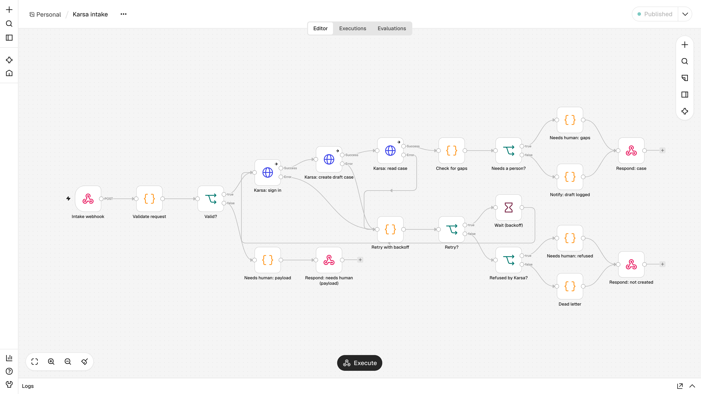
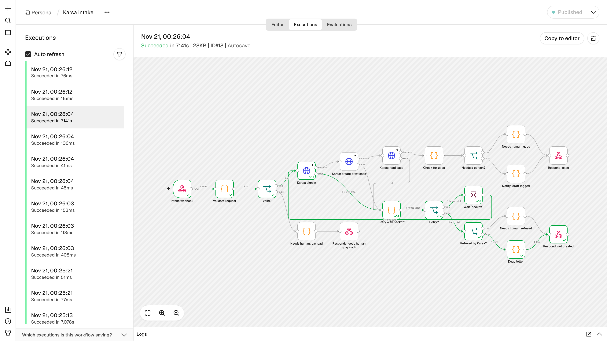

# n8n intake for Karsa

A self-hosted n8n workflow that takes an incoming business request, checks it, and creates a **draft** case in Karsa.
It never approves anything: approval stays in Karsa with its own rules (including two different approvers for
high-risk deals). Everything runs locally with synthetic payloads.



## What the workflow does

1. **Intake webhook** receives `POST /webhook/karsa-intake` with a JSON request.
2. **Validate request** checks the shared secret (`X-Intake-Secret`) and the required fields (`request_id`, `title`,
   `client_name`, `brief`). Anything missing goes to a person and nothing is sent to Karsa.
3. **Karsa: sign in** and **Karsa: create draft case** call Karsa's API as a synthetic demo analyst. The request is
   sent with `Idempotency-Key: n8n-<request_id>`, so a replayed webhook returns the case that already exists.
4. **Karsa: read case** and **Check for gaps** use Karsa's own extraction result: if a critical requirement is
   missing or conflicting, or the brief is flagged (for example a possible prompt injection), the request is routed
   to **Needs human: gaps**. Otherwise it is logged as a new draft.
5. **Retry with backoff** handles failed calls. Connection errors, timeouts, 408, 429 and 5xx are retried after
   1 s, 2 s and 4 s. Any other 4xx (for example a reused `request_id` with different content, 409) is a real
   refusal: it goes to a person and is not retried.
6. **Dead letter**: after the last retry the full request is written to `files/dead-letter.jsonl`, so it can be sent
   again later with the same idempotency key.
7. **Notifications** are a local mock: one JSON line per event in `files/notifications.jsonl`. No email, chat or
   WhatsApp account is used.



## Change in Karsa

`POST /api/v1/cases` now accepts an optional `Idempotency-Key` header (8-120 characters). The key is stored on the
case (`cases.intake_key`, unique per organisation; Alembic migration `a7c1e9d2b4f0`).

- Same key, same content: `200` with `Idempotent-Replay: true`, the existing case, and an audit event
  `case.intake_replayed`. No second case.
- Same key, different content: `409 IDEMPOTENCY_CONFLICT`.
- No key: unchanged behaviour.

Tests: `backend/tests/test_intake_idempotency.py` (4 tests).

## Run it

```bash
./integrations/n8n/setup.sh
python3 integrations/n8n/run_scenarios.py
```

`setup.sh` creates `.env` with random secrets, starts n8n 2.48.7 with Docker Compose on `127.0.0.1:5678`, imports and
publishes the workflow, and creates a local owner account for the editor (credentials in `.env`, git-ignored).
`run_scenarios.py` starts its own Karsa API on `127.0.0.1:8077` with a fresh, seeded SQLite database in a temp folder,
sends the sample payloads in `samples/`, checks each outcome in Karsa, and writes `RESULTS.md`.

## Scenario results

Last run: 9 of 9 passed. See [RESULTS.md](RESULTS.md).

| Scenario | Outcome |
|---|---|
| Valid, complete request | `201`, draft case created, no package or approval |
| Same webhook delivered twice | `200 already_received`, same case, no duplicate |
| Valid payload, unclear brief | `202 needs_human` with Karsa's reasons (lead definition and geography missing) |
| Missing required field | `422 needs_human`, nothing sent to Karsa |
| Wrong shared secret | `401` |
| Reused `request_id`, different content | `409 needs_human`, not retried |
| Karsa API down | `503 dead_letter` after 4 attempts (about 7 s of backoff), request kept |
| Dead letter replayed after Karsa is back | `201` then `200`, exactly one case |
| Nothing approved by the workflow | no package, approval or execution events on the cases it created |

## What this proves, and what it does not

It shows a working n8n intake in front of an approval system: validation, idempotent creation, a human-review branch,
retries with exponential backoff, a dead-letter path, and no automatic approval. The checks run against the real
Karsa API and a real n8n instance.

It does **not** show: a production deployment, real channels (email, WhatsApp, forms), real client data, load or
concurrency testing of n8n itself, or n8n credentials management (Karsa's demo login is passed through environment
variables). The optional LLM summary step was not added: there is no API key on this machine, and Karsa's own
extractor already structures the brief.
